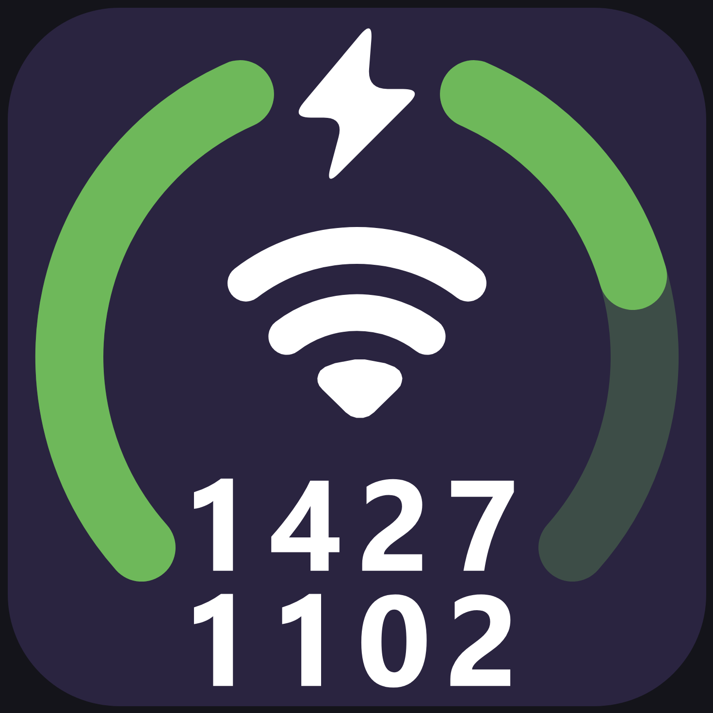
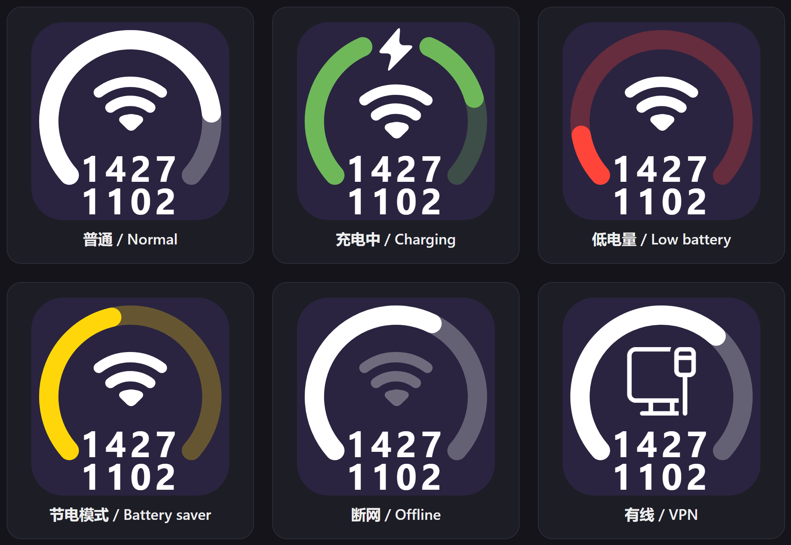
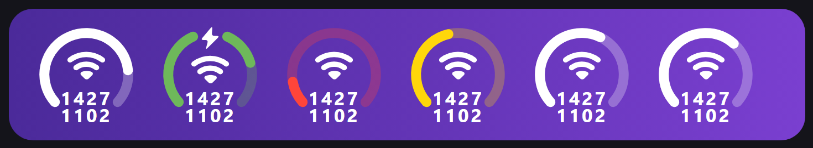

# Win Duo Bar

  

A compact ring widget for the Windows 11 taskbar clock: a battery gauge ring,
a Wi-Fi symbol and the time/date as two rows of four bold digits, with a
smooth charging animation. Every visual parameter can be tuned from the
settings page, which is bilingual (English / Chinese). The mod also carries
the tray icon tweaks (hide volume/network/battery/microphone/location/Studio
Effects/Recall/language bar/bell icons, grayscale battery icon, "Show desktop"
button width).

一个替换 Windows 11 通知区域时钟的圆环小组件：电量圆环 + Wi-Fi 图标 + 两行四位
的时间/日期数字，带平滑的充电动画。所有视觉参数都能在设置里调整（设置项中英双语）。
另外包含托盘图标隐藏功能（音量/网络/电池/麦克风/定位/工作室效果/Recall/语言栏/
通知铃铛，电池单色，显示桌面按钮宽度）。

## Features / 功能

**English**

- **Battery ring** – 263° gauge with round caps and a translucent track. The
  filled part follows the battery level. Green while charging, red when the
  battery is low (≤20%), yellow in battery saver mode, otherwise the taskbar
  text colour.
- **Wi-Fi symbol** – two thick rounded arcs plus a solid dot (geometry traced
  from the original 09 icon). It switches to the wired/VPN icon when the active
  connection is not wireless and dims when offline.
- **Time and date** – two rows of four bold digits, e.g. `1427` = 14:27 and
  `1102` = November 2nd, no separators.
- **Charging animation** – the top notch opens, a white lightning bolt grows
  out of the ring, the Wi-Fi symbol slides down slightly and the colours
  cross-fade (≈0.5 s at 60 fps).
- **Fully adjustable** – ring diameter/thickness/gauge span/track opacity/
  notch angle/bolt size, Wi-Fi size/thickness/opening/position, digits size
  and row positions, letter spacing.
- **Tray icon tweaks** – hide system tray icons (volume, network, battery,
  microphone, location/GPS, Studio Effects, Recall, language bar, language
  supplementary icons, bell), grayscale battery icon, hide time/date when the
  widget is disabled, and hide or resize the "Show desktop" button.

**中文**

- **电量圆环**：263° 圆环，圆头、带半透明轨道，填充部分随电量变化。充电绿色、
  低电量（≤20%）红色、节电模式黄色，其他情况跟随任务栏文字颜色。
- **Wi-Fi 图标**：两条粗圆头弧线 + 实心圆点（按原版 09 图标几何描出）；当前连接
  不是无线时显示有线/VPN 图标，断网时变暗。
- **时间日期**：两行四位粗体数字，例如 `1427` = 14:27、`1102` = 11月2日，
  不带分隔符。
- **充电动画**：顶部张开豁口、白色闪电长出、Wi-Fi 图标轻微下移、颜色渐变
  （约 0.5 秒，60fps）。
- **全部可调**：圆环外径/粗细/弧度范围/轨道透明度/豁口角度/闪电大小，Wi-Fi 尺寸/
  粗细/开口/位置，数字字号/两行位置/字间距。
- **托盘图标开关**：隐藏音量、网络、电池、麦克风、定位、工作室效果、Recall、
  语言栏、语言栏附加图标、通知铃铛；电池图标单色；widget 关闭时隐藏时间日期；
  "显示桌面"按钮的隐藏/宽度。

## Screenshots / 截图

| | |
|---|---|
|  |  |
| 各种状态：普通 / 充电 / 低电量 / 节电 / 断网 / 有线 | 任务栏中的效果（示意图） |

The screenshots are rendered by `preview/preview.html` from the same geometry
parameters as the widget (scaled up for readability). 截图由 `preview/preview.html`
按 widget 相同的几何参数放大渲染，不是任务栏截屏。

## Installation / 安装

> The mod is not in the official Windhawk repository yet, so install it
> manually for now. / 目前尚未上架 Windhawk 官方仓库，先手动安装。

**English**

1. Install [Windhawk](https://windhawk.net/).
2. Open Windhawk → **Mods** → the **"..."** menu → **Create a New Mod**
   (enable development mode if prompted).
3. Use `Win Duo Bar` as the name and `win-duo-bar` as the mod identifier.
4. Replace the generated source with the complete contents of
   [`win-duo-bar.wh.cpp`](win-duo-bar.wh.cpp) and click **Compile**.
5. When compilation succeeds, install and enable the mod, then restart
   Explorer (the taskbar will blink once).

**中文**

1. 安装 [Windhawk](https://windhawk.net/)。
2. 打开 Windhawk → **Mods** → 右上角 **"..."** 菜单 → **Create a New Mod**
   （如提示需要开启开发模式，按提示开启）。
3. 名称填 `Win Duo Bar`，Mod identifier 填 `win-duo-bar`。
4. 用 [`win-duo-bar.wh.cpp`](win-duo-bar.wh.cpp) 的完整内容替换编辑器里的源码，
   点击 **Compile**。
5. 编译成功后安装并启用 mod，然后重启一次 Explorer（任务栏会闪一下）。

After installation the widget takes over the notification-area clock. Turn
"Enable the Win Duo Bar widget" off to get the normal clock back.
安装后时钟由这个 mod 接管；关闭「启用 Win Duo Bar 小组件」即可恢复系统时钟。

## Settings / 设置

All settings are bilingual and every visual parameter is adjustable.
所有设置项均为中英双语，所有视觉参数都可调。

| Group | Settings (default) |
| --- | --- |
| Widget / 小组件 | Enable / 启用 (on), Size / 尺寸 (38 DIP), Time format / 时间格式, Date format / 日期格式, Show date row / 显示日期行 (on), Show network icon / 显示网络图标 (on) |
| Ring / 圆环 | Outer diameter / 外径 (35 DIP), Thickness / 粗细 (3.7 DIP), Arc span / 电量弧范围 (263°), Track opacity / 轨道透明度 (28%), Charging notch / 充电豁口 (48°), Bolt width-height / 闪电宽高 (7.2 × 9.1 DIP) |
| Wi-Fi | Height / 高度 (10.5 DIP), Width / 宽度 (14.5 DIP), Line thickness / 线条粗细 (2 DIP), Opening angle / 开口角度 (75°), Vertical position / 垂直位置 (41%), Drop while charging / 充电时下移量 (1.5 DIP) |
| Digits / 数字 | Font size / 字号 (7 DIP), Time row position / 时间行位置 (73%), Date row position / 日期行位置 (89.5%), Letter spacing / 字间距 (110) |
| Tray icons / 托盘图标 | Hide volume / network / battery / microphone / location / Studio Effects / Recall / language bar / language supplementary icons / bell, grayscale battery, clock time-date (only when the widget is off), "Show desktop" button width |

## Compatibility / 兼容性

- Windows 11 only (tested on Windows 11 26H2, build 26300). / 仅支持 Windows 11
  （在 Windows 11 26H2 build 26300 上测试）。
- Requires Windhawk 1.6+ (development mode to install a local mod). / 需要
  Windhawk 1.6+（本地安装 mod 需开发模式）。
- Windows updates may change taskbar internals; if the widget disappears after an
  update, check for an updated version of this mod. / Windows 更新可能改动任务栏
  内部结构；如果更新后 widget 不显示，请检查是否有新版本。

## Credits / 致谢

- [Windhawk](https://windhawk.net/) by ramensoftware / m417z.
- The tray icon tweaks part is derived from the
  [Taskbar tray system icon tweaks](https://github.com/m417z/my-windhawk-mods)
  mod by [m417z](https://m417z.com/), licensed under GPLv3.
  托盘图标隐藏部分派生自 m417z 的 Taskbar tray system icon tweaks 模组（GPLv3）。
- The Wi-Fi symbol geometry is traced from a "09"-style Wi-Fi icon reference.
  Wi-Fi 图标几何按 09 风格参考图标描出。

## License / 许可证

[GPLv3](LICENSE). Because this mod contains code derived from a GPLv3 mod, it is
licensed under GPLv3 as well. / 因为包含派生自 GPLv3 模组的代码，本项目同样使用
GPLv3 许可证。
